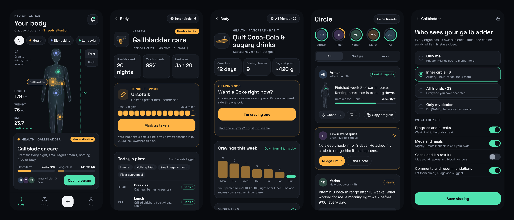
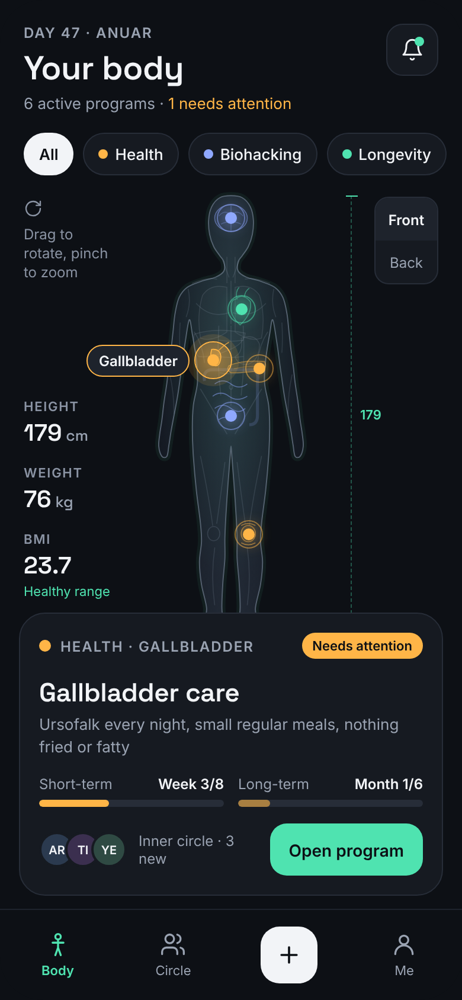
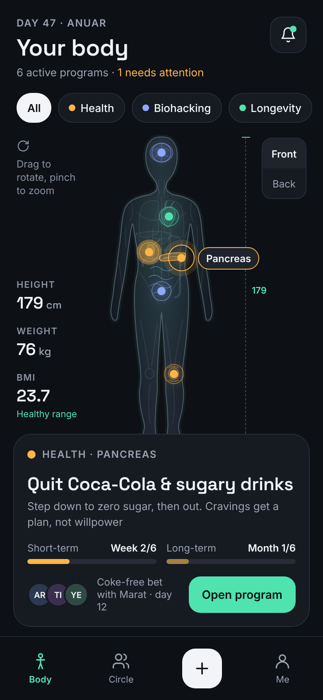
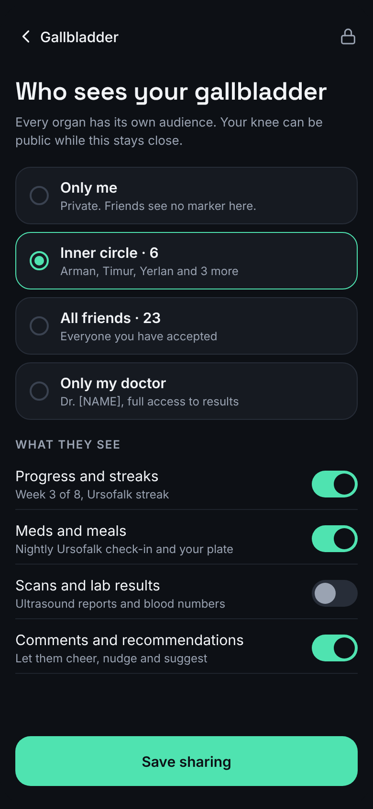
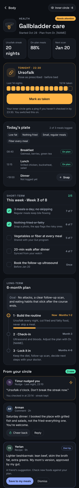
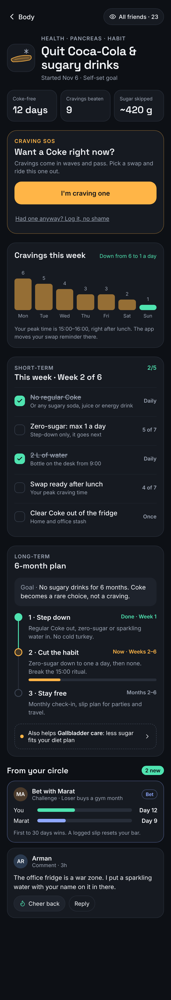
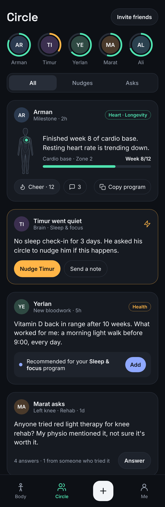

# Inner Circle

**See inside. Bring your inner circle.**

A social health, biohacking and longevity app. Your body is mapped in 3D, every organ you are working on carries its own program, and the friends you choose keep you on track.

> Status: concept / design sketch. Names, dates and numbers in the screens are examples.

## The idea

Most health apps show you numbers. Inner Circle shows you **your body** and what you are doing about it.

- **3D body map.** A see-through body with markers on the organs you are working on: gallbladder, pancreas, heart, brain, gut, a knee in rehab. Colour shows the track: Health, Biohacking or Longevity.
- **A program per organ.** Tap a marker to open its **short-term program** (this week's checklist) and **long-term plan** (phases over months, with a goal).
- **Your inner circle.** Friends you accept can follow a program, cheer milestones, nudge you when you go quiet, and suggest recipes, swaps or questions for your doctor.
- **Privacy per organ.** Each organ has its own audience and its own level of detail. Your knee rehab can be public while your medication stays with your closest people.

## Screens

| Body map | Body map: pancreas selected | Who sees this organ |
|:---:|:---:|:---:|
|  |  |  |
| Height, weight and BMI next to the body, markers per organ, a summary card for the selected program. | Every marker opens its own program. | Pick the audience (only me, inner circle, all friends, only my doctor) and what they see. |

| Gallbladder care | Quit Coca-Cola & sugary drinks | Circle feed |
|:---:|:---:|:---:|
|  |  |  |
| Nightly Ursofalk check-in with a 14-night streak, today's plate, weekly checklist, 6-month plan, notes from friends. | Craving SOS with swaps, cravings chart, step-down plan, a Coke-free bet with a friend. | Friends' progress rings, milestones to cheer, nudges for friends who went quiet, questions to answer. |

## Core mechanics

| Mechanic | What it does |
|---|---|
| **Nightly check-in** | One tap for a daily medication or habit. If you miss it, the circle can get a ping, but only when you have turned that on. |
| **Nudge** | A friend reminds you, but only on the programs where you asked for nudges. |
| **Cheer** | Light support on milestones and streaks. |
| **Bet / challenge** | Two friends, one goal, a stake (e.g. "first to 30 days Coke-free, loser buys a gym month"). |
| **Recommendation** | A friend suggests a recipe, a swap or a question for your doctor. It is labelled as a suggestion, not medical advice, and goes to a "discuss with doctor" list. |
| **Copy program** | Start a friend's protocol as your own. |
| **Linked programs** | Programs that help each other are connected (less sugar also helps gallbladder care). |

## Why this, and why now

| Who | What they do | What is missing |
|---|---|---|
| WHOOP Humans, Oura Circles, Apple Health sharing | Share wearable **metrics** (sleep, recovery, strain) with friends | No programs, no conditions, no plan |
| Function Health, Superpower, longevity coach apps | Blood tests plus a **personal plan** | You follow the plan alone |
| Medisafe (Medfriend) | Alerts a friend when you **miss a dose** | Narrow, built around caregivers |
| 3D anatomy apps (BioDigital, 3D Organon) | Detailed body models | Education only, nothing about *your* body |

Inner Circle sits in the gap: **organ-level programs + accountability from friends + a body you can see**. It works on top of the devices people already have (Apple Health, Oura, WHOOP) instead of competing with them.

## Principles

- **Programs over metrics.** The daily reason to open the app is the check-in, not the 3D model.
- **Treatment programs first, optimization second.** People on a real course (medication, diet, rehab) have higher stakes and a daily habit.
- **Privacy by design.** Health data is sensitive by default. Sharing is opt-in, per organ and per layer (progress, program steps, results).
- **Friends suggest, doctors decide.** Social recommendations never replace medical advice.

## First experiment

Recruit 15–20 people who are on an active treatment or habit program. Give half of them a circle with nudges and bets, and run it for 4 weeks. Compare daily check-in rates and week-4 retention between people with a circle and people without one.
